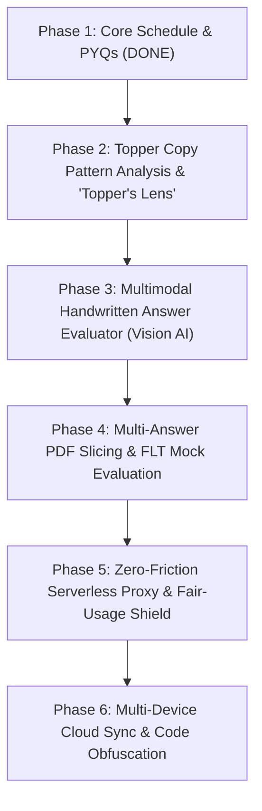

# UPSC AWFG Prep Engine: Comprehensive Product Roadmap & Feature Enhancements

> **Document Version:** 1.0  
> **Last Updated:** November 8, 2026  
> **Repository:** `ramansingh1511/awfg-tracker-for-mains`  
> **Live Deployment:** `https://ramansingh1511.github.io/awfg-tracker-for-mains/`  
> **Target Audience:** UPSC Civil Services Aspirants (Mains & Prelims)

---

## 🧭 Executive Summary & Platform Vision
The **UPSC AWFG Prep Engine** is evolving from a dynamic syllabus tracker and PYQ explorer into an **intelligent, topper-calibrated answer writing, framing, and evaluation ecosystem**.

This living document tracks all planned, ongoing, and completed enhancements. Features will be implemented systematically, one-by-one, following your feedback, topper copies, and specific prompt guidelines.

---

## 📊 Feature Status & Master Tracking Queue

| ID | Enhancement Name | Category | Priority | Status | Cost |
| :--- | :--- | :--- | :---: | :---: | :---: |
| **F-01** | Test Schedule & Cadence Engine (33 Tests / 90 Days) | Core System | High | `[x] Completed` | \$0 |
| **F-02** | Microthemes Synergy Mapping (210 Prelims & Mains Core) | Core System | High | `[x] Completed` | \$0 |
| **F-03** | Complete PYQ Repository (1,994 Prelims + 1,041 Mains + Ethics + Essay) | Data Engine | High | `[x] Completed` | \$0 |
| **F-04** | WYSK 1,697 Question Bank with Paper Filters & Search | Question Bank | High | `[x] Completed` | \$0 |
| **F-05** | Prelims Interactive Practice & Reset/Re-attempt Engine | Prelims | High | `[x] Completed` | \$0 |
| **F-06** | Mains Answer Pad with Stopwatch, Word Counter & Autosave | Mains Pad | High | `[x] Completed` | \$0 |
| **F-07** | Directive-based Structural Approach & 3-Part Template Inserter | Mains Pad | High | `[x] Completed` | \$0 |
| **F-08** | Topper Copy Pattern Analysis & "Topper's Lens" Blueprint Engine (Aditya, Ruhani, Ishita, Umaharathi, Medha, Anmol) | Mains AI/UI | High | `[x] Completed` | \$0 |
| **F-09** | Multimodal Handwritten Answer Evaluator (Gemini Vision) | Evaluation | High | `[ ] Up Next` | \$0 |
| **F-10** | Visual Layout, Margin Discipline & Diagram Recognition | Evaluation | High | `[ ] Planned` | \$0 |
| **F-11** | Novelty & Originality Scoring Engine (+0.5 to +1.0 Bonus) | Evaluation | Medium | `[ ] Planned` | \$0 |
| **F-12** | Multi-Answer PDF Slicer & Batch Mock Test Evaluator (20 Qs) | Document AI | Medium | `[ ] Planned` | \$0 |
| **F-13** | Zero-Friction Serverless Proxy with Managed Key Pool | Infrastructure | Medium | `[ ] Planned` | \$0 |
| **F-14** | Code Protection (JS Obfuscation & Minification) | Security | Medium | `[ ] Planned` | \$0 |
| **F-15** | Private GitHub Repo with Public Vercel/Cloudflare Deployment | Security | Medium | `[ ] Planned` | \$0 |
| **F-16** | Multi-Device Interoperability & Cloud Sync (Firebase/Firestore) | User State | Low | `[ ] Backlog` | \$0 |
| **F-17** | Real-Time Visitor & Traffic Analytics Dashboard | Analytics | Low | `[ ] Backlog` | \$0 |

---

## 📌 Phase-by-Phase Technical Specifications

---

### Phase 2: Topper Copy Pattern Analysis & "Topper's Lens" Engine (F-08)
> **Goal:** Deconstruct real UPSC topper answer copies (AIR 1–10 from VisionIAS, ForumIAS, Vajiram, etc.) and generate a dedicated "Topper's Blueprint" for every Mains PYQ.

#### 1. Analysis Dimensions from Topper Copies:
* **The "Hidden Demand" Extractor**: Average answers address only surface keywords. Topper copies divide 10M/15M questions into 2–3 distinct sub-queries (e.g. underlying causes, structural bottlenecks, stakeholder tensions).
* **Micro-Diagram & Schematic Patterns**:
  * Hub-and-Spoke models for multi-dimensional factors.
  * 3-tier concentric circles for governance/institutional layers.
  * Tabular comparative frameworks (Pros vs Cons / Current Mechanism vs Ideal State).
  * Directional timelines and geographical micro-maps.
* **Value-Addition Density Matrix**:
  * Exact Constitutional Articles (e.g., Art 21, 39A, 142).
  * Landmark Judgments (e.g., *Puttaswamy*, *NALSA*, *Shreya Singhal*, *Navtej Johar*).
  * Committees & Commissions (2nd ARC 4th report, Sarkaria, Punchhi, Law Commission 262nd).
  * Government reports & Indices (NITI Aayog Strategy @ 75, Economic Survey, UNDP HDI).
* **Subheading & Keyword Highlighting**:
  * Converting question demands directly into bold, underlined, examiner-friendly headings.

#### 2. UI Deliverable on Website:
* A new tab inside the Question Card: **"🏆 Topper's Framing"**.
* Displays:
  1. **Examiner's Contrast**: *What 90% of candidates write vs How a Topper structures it*.
  2. **Micro-Diagram Blueprint**: Textual and SVG schematic showing what to draw on the paper margin.
  3. **High-Yield Evidence Checklist**: Specific judgments and committees to incorporate.
  4. **Topper Conclusion Hook**: Standard forward-looking signoff (*Vision @ 2047, Constitutional Morality, SDG 2030*).

---

### Phase 3: Multimodal Handwritten Mains Evaluator (F-09, F-10, F-11)
> **Goal:** Allow aspirants to photograph or scan their handwritten answer sheets and receive forensic, topper-calibrated feedback at \$0 cost.

#### 1. Why Multimodal Vision (Gemini Flash):
* Native multimodal vision avoids fragile OCR libraries.
* Directly reads handwritten Indian cursive in physical page context.
* Preserves spatial layouts, margin annotations, and visual drawings.

#### 2. Visual & Formatting Audit:
* **Margin Discipline Check**: Detects if writing bleeds into the restricted margins.
* **Underlining & Boxing Audit**: Checks if keywords, case laws, and articles were visibly highlighted for fast skimming.
* **Diagrammatic Assessment**:
  * Detects presence of flowcharts, tables, and schematics.
  * Evaluates whether the diagram added value or acted as empty filler.

#### 3. Novelty & Distinction Bonus (+0.5 to +1.0 Marks):
* Detects non-cliché arguments, novel policy analogies, recent international precedents, and inter-disciplinary connections.
* Rewards unique synthesis over rote coaching-note memorization.

#### 4. Candidate Scorecard Format:
* **Overall Score**: Calibrated to real UPSC bell curve (e.g. `5.25 / 10`, indicating Topper threshold is `6.0+`).
* **Radar / Section Breakdown**:
  * Demand Fulfillment & Structure (out of 4.0)
  * Evidence & Value-Additions (out of 2.0)
  * Visual Presentation & Underlining (out of 2.0)
  * Diagrammatic Value (out of 1.0)
  * Novelty / Originality Bonus (out of 1.0)
* **Concrete Remedial Action**: Specific line-by-line pointers on what to add or rephrase.

---

### Phase 4: Multi-Answer PDF Slicer & Full Mock Evaluator (F-12)
> **Goal:** Handle large student uploads (from single question practice to 36-page, 20-question Full-Length Mocks) without crashing or hitting API limits.

#### 1. Technical Bottlenecks Addressed:
* Prevents `HTTP 413 Payload Too Large` errors from large scanned files.
* Bypasses the 8,192 output token limit by chunking answers.
* Prevents AI attention dilution and generic one-paragraph summaries.

#### 2. Architecture:
* **Single Question Practice**:
  * In-browser PDF thumbnail viewer (`pdf.js` / `pdf-lib`).
  * Candidate selects page range (e.g. *Pages 1–2*); browser extracts and transmits only those pages.
* **Full-Length Mock Test (FLT 20 Questions / 250 Marks)**:
  * Client-side chunker slices the 36-page PDF into 20 separate question payloads.
  * Runs a sequential batch queue with an interactive progress bar:
    `Evaluating Question 4 of 20... [██████░░░░░░] 20%`.
  * Produces an aggregated **Full Mock Diagnostic Report** with paper total out of 250 marks, weak-area heatmaps, and microtheme mastery.

---

### Phase 5: Zero-Friction Serverless Proxy & Key Management (F-13)
> **Goal:** Eliminate the friction of forcing students to create and paste Google AI Studio API keys, while keeping costs at \$0 and preventing quota abuse.

#### 1. Architecture:
* **Cloudflare Worker / Vercel Serverless Gateway**:
  * 100,000 free requests per day.
  * Secret pool of 2–3 free Gemini API keys stored safely in backend environment variables.
  * Automated key rotation if any single key hits the 15 RPM limit.

#### 2. Fair-Usage & Rate Shield:
* **Guest Quota**: Each student browser gets **3 to 5 free evaluations per day** automatically with zero login or setup.
* **Power User Bypass**: For students writing 20+ answers a day, an optional setting allows them to input their personal free Gemini key for unlimited daily evaluations.

---

### Phase 6: Code Protection, Deployment & Security (F-14, F-15)
> **Goal:** Keep the live website public for everyone, but ensure the GitHub repository remains private and source code cannot be easily stolen or scraped.

#### 1. Deployment Architecture:
* Switch GitHub repository visibility to **Private**.
* Connect private repo to **Vercel** or **Cloudflare Pages** (100% free forever).
* Website deploys publicly with automated git push updates, while GitHub code, commit history, and scripts remain 100% private.

#### 2. Code Obfuscation & Minification:
* Implement an automated build step (`terser` / `javascript-obfuscator`).
* Scrambles function names, variables, and data structures (`AWFG_APP` $\rightarrow$ `_0x4b12`), flattens control flow, and strips formatting.
* Renders the client-side code virtually unreadable in browser DevTools.

---

### Phase 7: Multi-Device Interoperability & Cloud Sync (F-16)
> **Goal:** Allow an aspirant to write an answer on their laptop, review it on their iPad, and check syllabus progress on their phone.

#### 1. Cloud Sync Engine:
* **Firebase Authentication**: One-click Google Sign-in.
* **Cloud Firestore (Free Tier)**:
  * 50,000 document reads, 20,000 writes per day free.
  * Automatically syncs test checkbox states, target date cadence, drafted answers, stopwatch records, and bookmarked questions.
* **Offline-First Fallback**:
  * Retains complete `localStorage` persistence when offline or signed out.
  * Seamlessly merges local progress with cloud profile upon login.

---

## 🛠️ Step-by-Step Implementation Protocol

When executing each feature:
1. **Requirement Confirmation**: Review user prompts, topper copies, or specific formatting rules.
2. **Local Sandbox Development**: Implement and verify code cleanly without breaking current live functionality.
3. **Automated Verification**: Test data integrity, responsiveness, and edge cases.
4. **Git Commit & Deployment**: Deploy to production with cache-busting version tags.
5. **Roadmap Update**: Mark the item as `[x] Completed` in this document.

---
*This document will be updated continuously as new topper copies and specific question-type prompts are added.*
